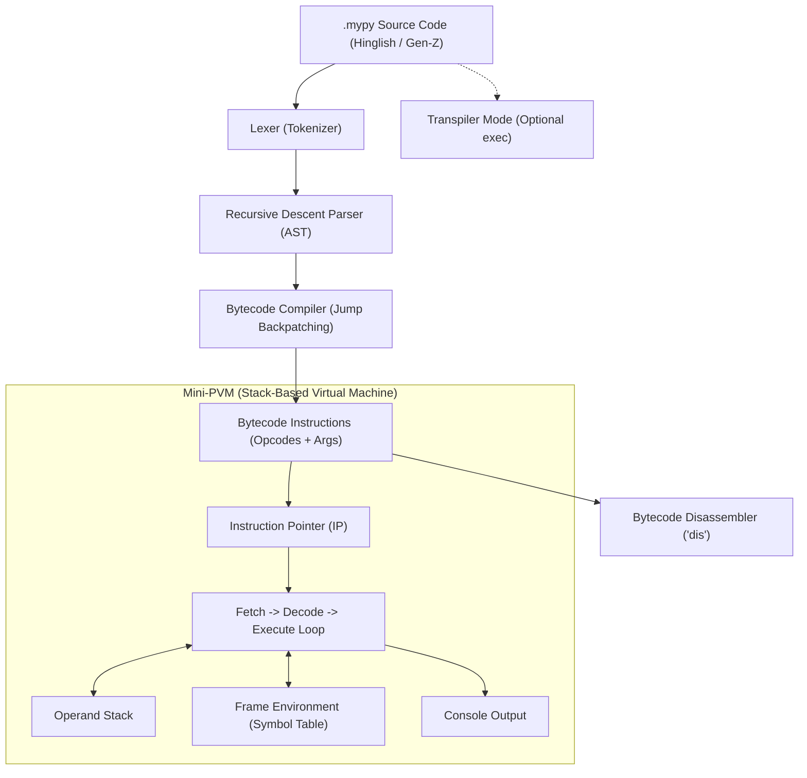

# 🌶️ Flavour: Custom-Keyword Python Dialect & Virtual Machine (Mini-PVM)

[](https://pypi.org/project/flavour-pvm/)
[](https://pypi.org/project/flavour-pvm/)

> **Published on PyPI as [`flavour-pvm`](https://pypi.org/project/flavour-pvm/)** — install directly via `pip install flavour-pvm`.

> **A custom vernacular Python dialect featuring an authentic Stack-Based Virtual Machine (Mini-PVM), Bytecode Compiler with Jump Backpatching, Disassembler, and Source Transpiler.**

Flavour allows developers to write code using custom vernacular keywords—such as **Hinglish** (`agar`, `warna`, `jabtak`, `likho`, `har`, `mein`) or **Gen-Z** (`lowkey`, `deadass`, `spin`, `spill`).

Unlike simple text-replacement tools, Flavour provides a **genuine Stack-Based Bytecode Virtual Machine (Mini-PVM)** that compiles source code into low-level bytecode instructions and executes them on an evaluation stack—mirroring how CPython's `ceval.c` works.

---

## System Architecture



---

## ⚡ Quick Start

### 1. Installation
Set up a clean virtual environment and install `flavour-pvm`:

```bash
# Create and activate virtual environment
python3 -m venv .venv
source .venv/bin/activate       # On Windows: .venv\Scripts\activate

# Install from PyPI
pip install flavour-pvm
```

*(Or if running directly from source code: `python flavour.py ...`)*

---

### 2. Create Your Code (`testy.mypy`)
Create a custom vernacular script named `testy.mypy`:

```python
# testy.mypy
likho("=== Namaste! Running on Custom Mini-PVM ===")

sankhya = 1
kul = 0

jabtak sankhya <= 3:
    kul = kul + sankhya
    likho("Ginti: " + str(sankhya) + " | Kul Jod: " + str(kul))
    sankhya = sankhya + 1

agar kul >= 5:
    likho("Status: Target reached! (Sahi)")
warna:
    likho("Status: Target not reached! (Galat)")
```

---

### 3. Run the Code on Mini-PVM
Execute your script directly using the installed `flavour` CLI:

```bash
flavour testy.mypy
```

Output:
```text
=== Namaste! Running on Custom Mini-PVM ===
Ginti: 1 | Kul Jod: 1
Ginti: 2 | Kul Jod: 3
Ginti: 3 | Kul Jod: 6
Status: Target reached! (Sahi)
```

---

### 4. Launch the Interactive REPL Shell
Start an interactive live terminal shell to write and run custom dialect code line-by-line:

```bash
flavour repl
```
```python
>>> naam = "Rahul"
>>> agar naam == "Rahul":
...     likho("Sab badiya!")
... 
Sab badiya!
```

---

### 5. Disassemble and View Bytecode (The PVM Inspector)
Inspect the compiled bytecode instruction stream, opcodes, and jump target addresses:

```bash
flavour dis testy.mypy
```
```text
ADDR   OPCODE                ARGUMENT / TARGET
-------------------------------------------------------
0000   LOAD_CONST            '=== Namaste! Running on Custom Mini-PVM ==='
0001   PRINT_VALUE           
0002   LOAD_CONST            1
0003   STORE_NAME            'sankhya'
0004   LOAD_CONST            0
0005   STORE_NAME            'kul'
0006   LOAD_NAME             'sankhya'
0007   LOAD_CONST            3
0008   COMPARE_OP            '<='
0009   POP_JUMP_IF_FALSE     to 0029
...
0028   JUMP_ABSOLUTE         to 0006
0029   LOAD_NAME             'kul'
0030   LOAD_CONST            5
0031   COMPARE_OP            '>='
...
0038   HALT                  
```

---

### 6. Transpile Mode (Source-to-Source)
Inspect the transpiled standard Python code:
```bash
flavour transpile examples/fizzbuzz.mypy
```

---

## ⚙️ Mini-PVM Instruction Set (Opcodes)

| Opcode | Argument | Description | Stack Effect |
| :--- | :--- | :--- | :--- |
| `LOAD_CONST` | `value` | Push constant onto operand stack | `[] -> [value]` |
| `LOAD_NAME` | `var_name` | Load variable value from environment | `[] -> [val]` |
| `STORE_NAME` | `var_name` | Pop top of stack and store in variable | `[val] -> []` |
| `BINARY_ADD` | - | Pop two operands, add them, push result | `[a, b] -> [a + b]` |
| `BINARY_SUB` | - | Pop two operands, subtract, push result | `[a, b] -> [a - b]` |
| `BINARY_MUL` | - | Pop two operands, multiply, push result | `[a, b] -> [a * b]` |
| `BINARY_DIV` | - | Pop two operands, divide, push result | `[a, b] -> [a / b]` |
| `BINARY_MOD` | - | Pop two operands, modulo, push result | `[a, b] -> [a % b]` |
| `COMPARE_OP` | `operator` | Pop two operands, compare (`<`, `>`, `==`, etc.) | `[a, b] -> [bool]` |
| `POP_JUMP_IF_FALSE`| `target_ip` | Pop top; if `False`, jump instruction pointer to `target_ip` | `[cond] -> []` |
| `JUMP_ABSOLUTE` | `target_ip` | Unconditionally jump `IP` to `target_ip` | `[] -> []` |
| `CALL_BUILTIN` | `(func, count)`| Call built-in helper (`str`, `int`, `len`, etc.) | `[args...] -> [res]` |
| `PRINT_VALUE` | - | Pop top of stack and print to console | `[val] -> []` |
| `HALT` | - | Terminate virtual machine execution | - |

---

## 📖 Keyword Cheat Sheet

| Hinglish Keyword | Standard Python | Meaning / Usage |
| :--- | :--- | :--- |
| `agar` | `if` | Conditional branch |
| `warna_agar` | `elif` | Else-if branch |
| `warna` | `else` | Else fallback |
| `jabtak` | `while` | While loop |
| `har` $\dots$ `mein` | `for` $\dots$ `in` | For loop over iterable |
| `ginte` / `ginti` | `range` | Range generator |
| `likho` / `batao` | `print` | Output print statement |
| `sahi` | `True` | Boolean true |
| `galat` | `False` | Boolean false |
| `shunya` | `None` | Null / None |

---

## 📁 Project Structure

```
flavour/
├── pvm/
│   ├── opcodes.py      # Opcode definitions and Instruction data classes
│   ├── lexer.py        # Tokenizer converting source to typed tokens
│   ├── parser.py       # Recursive descent AST parser
│   ├── compiler.py     # Bytecode generator with jump backpatching
│   ├── vm.py           # Stack-based Mini-PVM execution engine
│   └── disassembler.py # Bytecode formatter (like Python's 'dis' module)
├── flavour.py          # Unified CLI (run, dis, transpile, repl)
├── dialects.py         # Keyword dictionaries (Hinglish, Gen-Z)
├── test_pvm.py         # Unit tests for the Virtual Machine & Compiler
├── test_flavour.py     # Unit tests for the Transpiler
├── README.md           # Documentation & presentation guide
└── examples/
    ├── loop.mypy       # While-loop accumulator on Mini-PVM
    ├── branch.mypy     # Multi-branch conditionals (agar/warna_agar/warna)
    ├── calc.mypy       # Arithmetic calculator and expressions
    └── fizzbuzz.mypy   # Range-based loops and modulo logic
```

---

## 🧪 Running the Tests

To verify both the Virtual Machine and Transpiler suites:

```bash
python3 test_pvm.py -v && python3 test_flavour.py -v
```

All 18 tests verify tokenization, AST generation, jump address calculation, stack arithmetic, loop execution, and disassembly.
